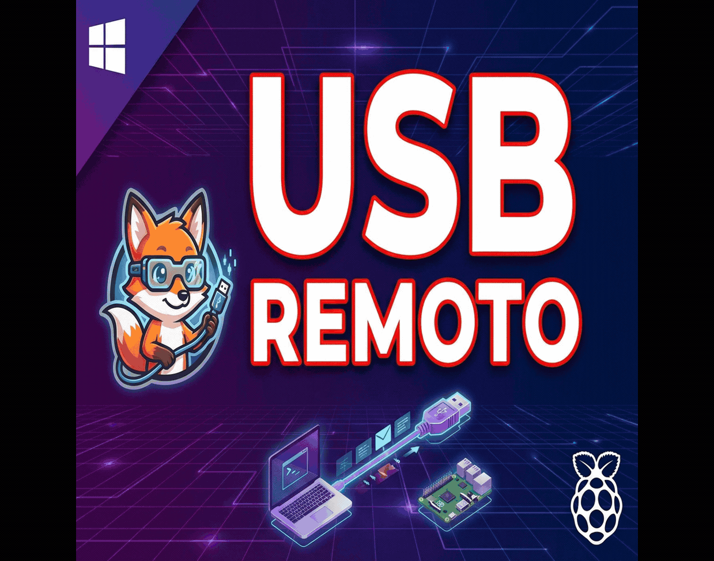

# 🌐 USBAnywhere — The Free, Open-Source VirtualHere Alternative for Windows

> *Formerly known as **SnakeUSBIP***

🌐 **Language / Idioma:** **English** | [Español](README_ES.md)

**v3.0.0** | [Download Latest](https://github.com/oscarlosu-lab/USBAnywhere/releases/latest) | [📖 User Manual](docs/USAGE_EN.md) | [🌐 VPN Connection](docs/VPN_INTERNET_EN.md)

> **Why pay $49.00 per server and be restricted to a single USB device?**
> **USBAnywhere** connects **unlimited** remote USB peripherals over LAN, Wi-Fi, and Internet with **zero licensing fees**, **Microsoft WHQL-certified drivers**, and **tunable ultra-low latency**.

Transform any Linux device (or Windows PC) into a high-performance Virtual USB Hub accessible from Windows 10 and 11. Compatible with **Raspberry Pi, Orange Pi, Banana Pi, Proxmox/HomeLab, Steam Deck, OpenWRT routers, CrealityBox**, and any ARM/x86 Linux server.

[](https://github.com/oscarlosu-lab/USBAnywhere/releases)
[](https://github.com/oscarlosu-lab/USBAnywhere/stargazers)
[](LICENSE)
[-lightgrey?style=flat-square&logo=windows)](https://github.com/oscarlosu-lab/USBAnywhere)

---

## ⚔️ Why Switch from VirtualHere to USBAnywhere?

| Feature | **USBAnywhere v3.0** | **VirtualHere** | **USB Network Gate** |
| :--- | :---: | :---: | :---: |
| **Price & License** | **100% Free & Open Source (GPLv3)** | $49.00 USD / Server | $159.00+ USD |
| **Simultaneous Devices (Free)** | **♾️ Unlimited** | ⚠️ 1 Device Only | ❌ Trial Expired |
| **1-Click Linux Server Setup** | ✅ **Built-in SSH Auto-Installer** | ❌ Manual CLI setup | ❌ Proprietary daemon |
| **Latency & Network Modes** | ✅ **Dual: Low-Latency WSK & Zero-Copy** | ⚙️ Generic | ⚙️ Generic |
| **User Interface** | ✅ **Modern WPF (Dark & Light Themes)** | 🕰️ Legacy Win98 TreeView | 💻 Heavy Commercial UI |
| **Drivers (Windows 10/11)** | ✅ **Microsoft WHQL Certified (HVCI Ready)** | ✅ Signed | ✅ Signed |
| **Native VPN Integration** | ✅ **Built-in Tailscale & ZeroTier Peers** | 💰 Extra / Manual | ❌ Manual |

---

## 🎯 Built for the Communities Left Behind by Paywalls

1. 🎮 **Cloud Gaming, Moonlight / Sunshine & Steam Deck**
   Pass Xbox/DualSense controllers (with full rumble, adaptive triggers, and audio), wireless headset dongles, and keyboards from your living room Raspberry Pi or handheld directly to your gaming rig.
2. 🏎️ **SimRacing & Flight Simulators (HOTAS / VR)**
   Connect steering wheels, load-cell pedals, shifters, button boxes, and VR trackers simultaneously over Ethernet using **Low-Latency WSK mode** without hitting a 1-device paywall.
3. 🖨️ **3D Printing (Klipper, Mainsail, OctoPrint, CrealityBox)**
   Bridge multiple USB webcams, ADXL345 resonance accelerometers, and printer mainboards effortlessly.
4. 🖥️ **HomeLab, Proxmox & Self-Hosted**
   Attach Zigbee/Z-Wave coordinators, hardware security keys, and license dongles (AutoCAD, iLok, eToken) over LAN or Tailscale VPN.

---

## 🎬 Video Tutorial

<a href="https://youtu.be/tICyZ-5VeWc">
  
</a>

▶️ **[Watch full tutorial on YouTube](https://youtu.be/tICyZ-5VeWc)** (Spanish audio, visual guide)

---

## 🆕 What's New in v3.0.0 (USBAnywhere Rebrand)

- 🌐 **Rebranded to USBAnywhere** - A modern identity built to be the #1 open-source alternative to VirtualHere and VirtualUSB, with automatic configuration migration from `SnakeUSBIP` v2.x.
- ⚡ **1-Click SSH Server Auto-Setup** - Turn any Raspberry Pi, Debian, or Ubuntu machine into a ready-to-use USB over IP server with a single click directly from the SSH dialog.
- ⚡ **Dual Performance Modes** - Choose between `zero-copy` (high bandwidth storage/video) and `low-latency` (fast WSK event callbacks for HID/gaming/SimRacing).
- 🔌 **Graceful Detach on Exit** - Automatically frees connected remote USB ports when closing the app, preventing locked sockets on the server.
- 🛡️ **Certified WHQL Drivers** - Official Microsoft-certified drivers for Windows 10/11 x64 with full Core Isolation (HVCI) support.
- 🛠️ **Real-Time PnP UDE Device Management** - Active hardware queries via `pnputil /enum-devices` and conflict-free node creation with `devnode.exe`.
- 📦 **Hybrid Portable Mode** - ZIP releases store config locally, installer uses `%AppData%\USBAnywhere`.
- 📚 **Updated USB Database** - Latest `usb.ids` with 25,000+ recognized devices.

---

## ✨ Key Features

- 🔍 **Auto-Discovery** - Scan for USB/IP servers across your local network in seconds
- ⚡ **1-Click SSH Provisioning** - Install and start `usbipd` on your Raspberry Pi/Linux server automatically
- 🌐 **Internet Connection** - Connect anywhere via Tailscale or ZeroTier (NAT traversal)
- ⚡ **Tunable Latency** - Zero-copy throughput or low-latency WSK packet handling
- 🔌 **One-Click Connect & Auto-Disconnect** - Connect/disconnect devices cleanly
- ⭐ **Favorites & Auto-Reconnect** - Save devices with automatic reconnection and per-device latency profiles
- 📋 **Detailed Hardware Info** - Real-time VID:PID and vendor lookup for 25,000+ USB devices
- 🎨 **Modern Native GUI** - Fast .NET 9 WPF interface with Dark and Light themes
- 🌐 **Multi-language** - Instant switching between English and Spanish
- 🔄 **Secure Auto-Update** - Verifies GitHub releases with mandatory SHA-256 cryptographic checks

---

## 📦 Installation

### Option 1: Portable (No installation required)
1. Download from [Releases](https://github.com/oscarlosu-lab/USBAnywhere/releases/latest):
   - **Windows x64**: `USBAnywhere-v3.0.0-x64.zip`
   - **Windows ARM64**: `USBAnywhere-v3.0.0-arm64.zip` (Surface Pro X, Snapdragon X Elite, etc.)
2. Extract the ZIP to any folder
3. Run `USBAnywhere.exe` as Administrator
4. Done!

### Option 2: Installer (x64 Recommended)
1. Download `USBAnywhere_Setup_v3.0.0.exe` from [Releases](https://github.com/oscarlosu-lab/USBAnywhere/releases/latest)
2. Run the installer as Administrator
3. Follow the installation wizard

### ⚠️ ARM64 Users
ARM64 drivers are **test-signed**. See `README_ARM64.md` in the ZIP for instructions to enable Windows Test Mode.

---

## 🚀 Quick Start

1. **Scan** - Click `🔍 Scan` to find servers on your network
2. **List** - Click `📋 List` to see available USB devices
3. **Connect** - Double-click a device or right-click → Connect
4. **Disconnect** - Right-click → Disconnect

### ⚡ 1-Click Linux / Raspberry Pi Server Setup
1. Click `🔗 SSH` in the top toolbar
2. Enter your Raspberry Pi / Linux username (e.g. `pi` or `root`) and IP
3. Click **`⚡ 1-Click Auto-Setup`** — it automatically installs `usbip`, loads kernel modules persistently, starts the daemon, and lists your USB ports!

**Or run our 1-Line Plug & Play Installer on Linux / Raspberry Pi:**
```bash
curl -sSL https://raw.githubusercontent.com/oscarlosu-lab/USBAnywhere/main/scripts/install-server.sh | sudo bash
```
> 💡 **100% Plug & Play (Like VirtualHere!):** Installs `usbipd`, creates a `systemd` service, and adds a **`udev` hotplug rule** that **automatically exports any USB device as soon as you plug it into your Raspberry Pi/Linux server** — zero manual `usbip bind` commands required!

### 🐳 Docker / HomeLab / NAS Server (`docker-compose.yml`)
Run a Plug & Play USB/IP server on **Unraid, TrueNAS, Synology, or Proxmox** using [`docker/docker-compose.yml`](docker/docker-compose.yml):
```bash
git clone https://github.com/oscarlosu-lab/USBAnywhere.git && cd USBAnywhere/docker && docker compose up -d
```

### 🎮 Moonlight / Sunshine / Playnite CLI Automation
Automate controller, wheel, or headset attachment when starting a game stream:
```powershell
USBAnywhere.exe --minimized --connect 192.168.1.50 1-1.4
```

### 🌐 Internet Connection (VPN)
1. Install **[Tailscale](https://tailscale.com/download)** on Windows and your server
2. Click `📡 VPN` to see peers with active USB/IP
3. Select a remote server and connect

See [docs/VPN_INTERNET_EN.md](docs/VPN_INTERNET_EN.md) for the complete guide.

---

## 🐧 Manual Linux Server Setup (Optional)

Works on **any Linux device** with USB ports (Raspberry Pi, Orange Pi, Banana Pi, OpenWRT, CrealityBox, Debian/Ubuntu x86/ARM):

**Debian / Ubuntu / Raspberry Pi OS:**
```bash
sudo apt update && sudo apt install -y usbip hwdata usbutils
sudo modprobe usbip_host
sudo usbipd -D
sudo usbip list -l
sudo usbip bind -b 1-1.4  # Replace with your bus-id
```

**OpenWRT:**
```bash
opkg update && opkg install usbip-server kmod-usb-ohci
usbipd -D
```

See [docs/RASPBERRY_PI_SERVER_EN.md](docs/RASPBERRY_PI_SERVER_EN.md) for complete instructions.

---

## 📁 Structure

```text
USBAnywhere/
├── USBAnywhere.exe     # Main application (.NET 9 WPF)
├── usbipw.exe          # USB/IP client binary
├── devnode.exe         # PnP UDE device node manager
├── libusbip.dll        # USB/IP core library
├── drivers/            # Microsoft WHQL-certified x64 drivers
├── usb.ids             # USB vendor/product database (25,000+ entries)
├── CleanDrivers.ps1    # Driver cleanup utility
└── icon.ico            # Application icon
```

---

## 📄 License

GPL v3 (GNU General Public License) - See [LICENSE](LICENSE)

## 🙏 Credits

| Project | Author | Contribution |
|---------|--------|--------------|
| [usbip-win2](https://github.com/vadimgrn/usbip-win2) | **Vadim Grn** | Microsoft-signed USB/IP drivers (WHQL certified). Core of the Windows client. |
| [OctoWrt](https://github.com/ihrapsa/OctoWrt) | **ihrapsa** | Original OpenWrt guide for CrealityBox. Inspiration for embedded device support. |
| [OctoWrt Fork](https://github.com/shivajiva101/OctoWrt) | **ShivaJiva** | Active OctoWrt maintenance. Updated releases for CrealityBox. |
| [USB/IP](https://www.kernel.org/doc/html/latest/usb/usbip_protocol.html) | **Linux Kernel** | Original USB/IP protocol |
| **USBAnywhere** *(ex-SnakeUSBIP)* | **SnakeFoxu** | .NET 9 WPF GUI, 1-Click SSH setup, VPN integration, latency modes & documentation |
